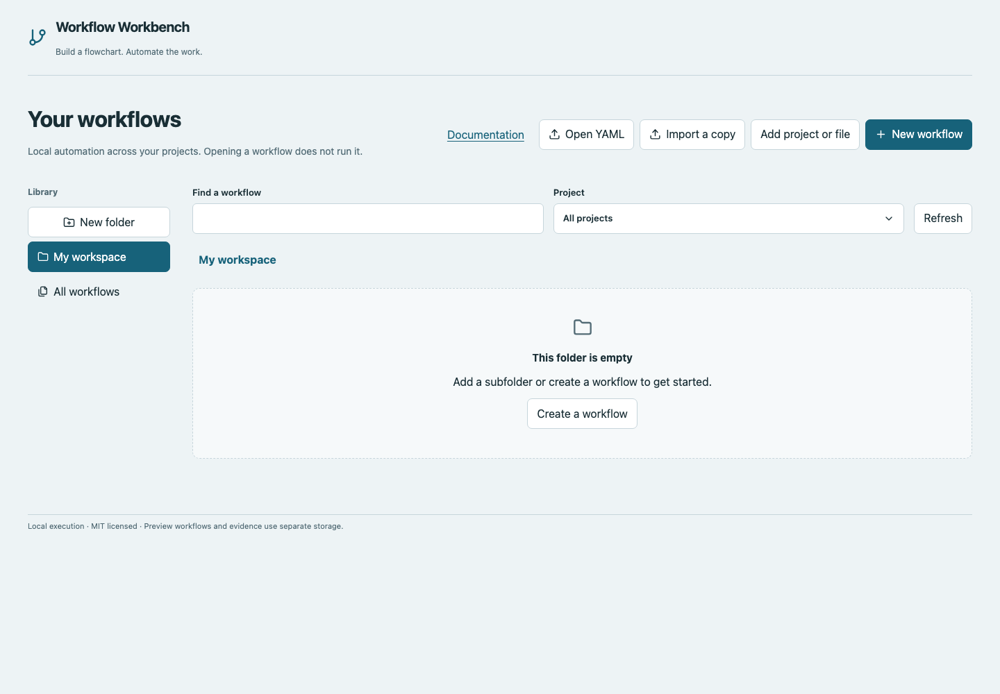
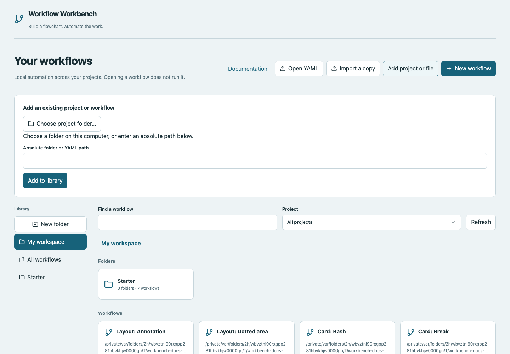

# Home and projects

Home is a directory of workflow entry points across local project folders. A project contains actual YAML/scripts. A Home folder is an organizational label; moving an entry between Home folders normally leaves its file on disk.

## Add a project or existing file

1. Choose **Add project or file**.
2. Choose **Choose project folder…** to open the host's native folder picker. On a local Mac this is the Finder-style folder dialog; Windows uses its folder selection dialog. Linux needs Zenity or KDialog.
3. Review the absolute path, then choose **Add to library**.
4. Or paste an absolute folder/YAML path directly. Cancelling the system picker preserves the existing field value.

The picker opens on the computer running the server, not a remote browser device. It does not upload an entire directory. Registration discovers top-level `.yaml`/`.yml` files; nested workflow folders must be added separately. Missing native UI/headless hosts can use the path field.

## Open YAML versus register a path

**Open YAML** uses a native file picker to register the original YAML in place. Its relative workspace paths and `library.imports` retain the original project location, so child workflows are imported recursively into their declared Home folders. No workflows execute during import. If a native picker is unavailable, use **Add project or file** and enter the original absolute YAML path.

**Import a copy** uses the browser's file picker to read YAML contents, then asks for a destination project and filename. It creates a new file and refuses overwrites. A browser upload cannot supply its original absolute path or neighboring files. Use **Open YAML** for a project entry point such as AirDeck's `release-workbench.yaml`.

To edit an existing file in place, register its absolute path with **Add project or file** instead. Always bring companion scripts/child YAML files into the chosen project directory when importing a download.

## Browse the folder grid

Home displays **Folders** and **Workflows** as a responsive grid. Open a folder tile to browse its direct children; the breadcrumb above the grid shows your location. Choose a breadcrumb to go back to any parent. **My workspace** is the library root; **All workflows** shows entries across every folder. Search in a folder includes its descendants; search from the root or All workflows searches the whole library. The Project filter still limits workflow entries to a registered project.

Open a workflow with **Open workflow**, or double-click its tile. Opening never starts execution. Long paths are shortened visually; hover over the path to read it in full.

## URLs, refresh and browser navigation

The default Home location is **My workspace**, showing root folders and workflows stored directly at the library root. All workflows remains a separate view for entries across every folder.

Every folder has a readable path URL, such as `/folders/Automation/Checks`. Opening folders, choosing a project filter or searching updates the address bar. Copy that address to return to the same location. Refresh and browser Back/Forward restore the folder and filters rather than resetting Home.

Workflow URLs also record **Edit/Run**, **Flowchart/List/Yaml**, the open function graph, selected card and Workflow settings. Opening a workflow preserves its Home folder/filter context; the Home button returns there. Older query-based links still work and are normalized to the new path format. Search (`q`) and project filters can remain query parameters after a named path; the main page identity is in the path. On narrow screens, a link without an explicit representation defaults to List.

| Example URL | Opens |
|---|---|
| `/workspace` | My workspace (also the default when opening `/`) |
| `/folders/Automation/Checks` | Checks inside Automation |
| `/workflows` | All workflows |
| `/folders/Automation?q=smoke` | Search within Automation and descendants |
| `/workflows/ID/edit/list` | An editor in List view |
| `/workflows/ID/edit/canvas/functions/condition/cards/result` | A function graph and its selected card |
| `/workflows/ID/settings` | Workflow settings |

These are local library links: workflow IDs and project paths must exist in the same dashboard/library. They do not publish workflows or transfer projects to another machine. Workflow links may retain a `folder` query value so Home returns to the folder you came from. It is navigation context, not the workflow identity. The URL identifies the saved workflow location, not a copy of an unsaved draft, credentials or a historical run. Use saved report links for historical evidence. If a folder link points to an item that was removed/renamed, Home explains that the folder was not found and offers My workspace.

Leaving a workflow with unsaved changes through Home or browser history within Workbench prompts before discarding it. **Keep editing** preserves the current draft; **Discard draft and continue** follows the requested navigation. Save before a full browser reload or closing a tab; URLs do not replace draft backups.

## Create and organize workflows

**New workflow** asks for name, project, YAML filename and Starter template. Blank gives Start → Finish; other templates demonstrate specific capabilities. Create workflow becomes available after the required name, filename and project folder are ready. The file is created only when you submit the form. When browsing a folder, a newly created or imported workflow is placed in that library folder. From All workflows, new entries start at the root.

### Create a folder or subfolder

1. Choose **New folder** and enter a **Folder name**.
2. Review **Parent folder**: it defaults to the folder you are browsing, or My workspace from All workflows.
3. Choose **Save**, then open the new folder tile.
4. Repeat to create another level, or right-click an existing folder and choose **New subfolder**.

Folder names must be unique within their parent; two different parents may both contain a folder called Tests. Use one name at a time, without `/`, `\`, `.` or `..` path components. Folders are logical library metadata, not new directories on disk.

### Rename and move

Right-click a folder tile or its sidebar shortcut to **Rename folder** or **Move folder**. Moving/renaming updates its complete subtree and the workflow memberships inside it. Choose a destination in **Move to folder**, then **Save**. A folder cannot move into itself or its descendants, and same-name destination collisions are rejected before anything changes.

Right-click a workflow tile and choose **Move to folder**, select any nested destination, then **Save**. Moving a workflow changes its library membership without moving its YAML file. Keyboard users can focus a tile and press **Shift+F10** to open the same menu; folder tiles also open with Enter/Space.

### Remove a library folder

Right-click a folder and choose **Remove folder**. Confirm with **Save**, or **Cancel** to keep it. This removes the folder and all its subfolders from the library, bringing their workflow entries into the removed folder's parent. Removing a top-level folder brings entries to My workspace. It never deletes YAML, scripts, project directories or run evidence.

Folder organization persists in library.json, including user changes to Starter folders. Project filtering remains independent of library folders and does not move files.

**Refresh** reloads registered entries. Register a project again to discover newly added YAML files. Invalid or missing files remain visible with an explanatory error instead of appearing runnable. Correct the file/path before opening it again.

## Remove workflows or projects from Home

Right-click a workflow row and choose **Remove from Home**. Review the confirmation, then choose **Remove from Home** again. **Cancel** keeps the entry.

To remove an entire project, select it in the **Project** filter, then choose **Remove project from Home**. Confirmation removes its workflow entries, including registered files within nested folders.

These actions only remove library entries. YAML files, project directories, saved drafts and historical run reports remain on disk. Removed entries stay hidden after refresh or restart, including Starter entries. To restore them, use **Add project or file** with the original path; adding a project again discovers its top-level YAML files. Stop active runs before removing their workflow or project.

Workbench does not delete files or directories from disk through these controls. Use your file manager if you also want to delete physical files.

## Starter versus personal workflows

Starter examples live in `<storage>/projects/starter` and appear in Home's **Starter** folder. Startup creates missing examples without overwriting existing edits. Make a copy into your own project when building real automation, with the scripts/resources it needs. Do not rely on clearing Home folders to delete disk files.

The current development setup may preserve edited former examples as personal workflows and provide fresh Starter copies separately. Their names can match; use the displayed file path and project filter to distinguish them.

## History and opening work

Opening an entry does not execute commands. Home can display previous run reports separately from current workflow configuration. Read [running and evidence](running.md) for how fresh runs differ from resume. Before moving project files manually, see [storage and backups](storage.md); library IDs and evidence references need deliberate handling.
