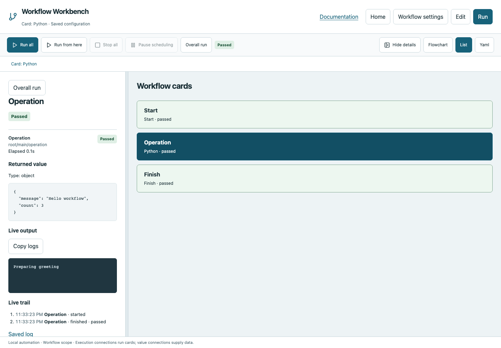
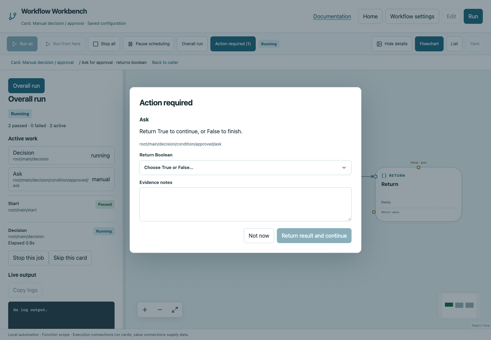

# Run and inspect workflows

## Start a fresh run

Save and validate your workflow, then choose **Run → Run all**. Review the declared workflow inputs in the dialog when present. [Run inputs and discovery](inputs.md) explains required/default values and the optional **Auto-detect inputs** button. A fresh run starts at main Start, resets globals to initial values, and can repeat all external side effects. Opening the project or choosing Run view alone does not execute cards.

Execution follows wires, not canvas positions. If selects one path; While may run zero iterations; Parallel is the only explicit concurrent fan-out. Editing is locked during active execution.

## Run from a selected card

1. Save and validate the workflow, then open **Run**.
2. Select an executable card on the Flowchart or in List view.
3. Choose **Run from here** beside **Run all**.
4. Review inputs when prompted. Cards inside a function use that function's declared inputs.
5. Workbench starts at this card and follows execution connections to **Finish**, or **Return** in a function. It centers and zooms to the starting card; List scrolls to it. You can pan or scroll freely afterward.

This is a new partial run, not a single-card test. Next, True/False and Done connections are followed normally. Functions, child workflows, loops, Parallel and recovery regions execute with their usual behavior. Cards reached after the starting point execute again, even if they succeeded in the previous run; they may repeat external side effects. Earlier commands do not run automatically.

When inspecting a stopped/completed execution, Workbench can reuse its successful upstream results and recorded variable changes. The workflow, source files, inputs, secrets and workspace must match. In a normal saved-workflow tab with no current execution, it can find the latest compatible saved evidence. Failed, redacted, downstream and incompatible results are excluded. The left panel's **Reused earlier results** section and report record where reused data came from. Globals begin at their declared values, then eligible upstream changes are restored; the old run's final globals are not copied wholesale.

For example, run **Parallel race checks**, then stop before a later stage. Select **Collect race results** (Join) and choose **Run from here**: the Join collects the completed Parallel output and proceeds to its next card, without rerunning the race commands. If that Parallel never passed or its output no longer matches the current configuration, the error names the missing producer. Start from the producing Parallel card instead. Missing earlier outputs are never replaced with assumed success.

Break, Continue and cards inside controlled bodies need their enclosing control-flow context. Start from the owning Loop, Parallel or Try instead. Layout areas cannot run. The button is disabled without a selected card, while any workflow is executing or for unsaved edits.

In a stopped child execution tab, **Run from here** uses its configuration snapshot, opens the new run URL in the same tab and preserves the old evidence. It does not resume the parent. **Open definition** opens the current saved file for editing. Stop, manual prompts, resource locks, timeout, retries and live logs remain available.

Partial reports identify their starting card and any reused evidence. Passing the remaining path does not independently approve the entire release workflow. A partial report cannot be silently resumed as a full-workflow approval.


## Overall and selected inspection

In **Run** view, right-click a card on the Flowchart or in List view and choose
**Mark to skip** before starting, or **Skip this card** during execution. The
execution details use the same review. A gentle border pulse previews affected
visible cards; reduced-motion preferences use a static outline. Review the cards,
scopes, reasons, continuation and any blocking issues, then choose **Confirm skip**.
**Cancel** or Escape leaves execution and saved marks unchanged. Execution keeps
moving during review; a changed preview must be reviewed again.

Explicit marks are saved in YAML as `skip_cards: [{graph: main, card: card-id}]`
and apply across future invocations and fresh runs. **Marked to skip** badges are
separate from execution status. The skipped-card summary explains inherited and
missing-result skips. **Unmark** removes an explicit mark; independently marked
descendants remain marked. **Unmark for future runs** never replays consumed work.

Skipping Loop, Parallel or Try bypasses its owned scopes and follows Done. Calls
and workspace cards bypass that invocation without editing shared functions or
child files. Skipping If bypasses its condition and both branch regions, resuming
at an unambiguous common continuation; otherwise confirmation is blocked. Start,
Finish, Return, Break and Continue cannot be explicitly marked.

Skipped cards produce no value. Value wires, nested card references and implicit
Join dependencies propagate skips transitively. Independent execution successors
continue. A required Finish or Return losing its result blocks confirmation;
Returns inside wholly bypassed child scopes do not. Script side effects are not
inferred. Completed work and side effects are retained. Confirming during a run
cancels remaining owned work and saves the mark for future runs. Historical
completed execution pages remain read-only; open the definition to change marks.
Run details and reports identify skips and their reasons. A passing run containing
skips does not verify the full workflow.

Overall run shows workflow status, counts, active paths and elapsed/progress information. The canvas/List can follow active work automatically. Selecting a card, dragging the canvas or scrolling away switches to specific-card inspection and disables following. **Overall run** in the left panel returns to the overview and follow-active behavior.

Select a card to see its live logs, event trail, attempts, elapsed time and typed return value. Parent structural/function cards include relevant child evidence; repeated executions have hierarchical paths identifying invocation/iteration. A completed card's details remain inspectable.



| State | Interpretation |
|---|---|
| pending / queued | Not started or awaiting coordinator resources |
| running | Executing or coordinating active children |
| waiting for manual evidence | Operator action is needed in the browser prompt |
| passed / recorded | Successful operation or recorded intervention |
| failed | Command, contract, timeout or workflow error |
| skipped | Unselected branch, unexecuted body, or card explicitly skipped by the user |
| cancelled | Explicit Stop, distinct from failure |
| blocked | Required evidence or deliberate resume action is missing |

Labels accompany colors: passed green, failed red, skipped/cancelled grey; running has a green border animation that respects reduced-motion settings.

## Human decisions

Manual cards open an evidence prompt. Enter notes and choose the required Boolean decision or record approval. Each invocation needs a new response, even within a loop. False is valid data; use If to branch on it. If you dismiss the prompt, reopen the waiting intervention from the run controls. Noninteractive runs block instead of assuming approval.



## Stop and pause

**Stop all** cancels active and pending work, propagating to child workflows and processes. A selected job's stop control targets its execution subtree. Already completed side effects remain. Detached processes that escape process groups and observation are outside the cleanup guarantee.

**Pause scheduling** prevents new operations/cards from starting; it does not suspend an already running command. Resume scheduling when ready. Stop is not a request to execute additional Finally cleanup commands; cancellation does not launch new user cleanup work.

## Measured progress versus estimates

A command can emit newline-terminated progress records:

```text
::workbench::{"done":3,"total":10,"stage":"Checking packages"}
```

Use `print` in Python for such log lines, not the return channel. Values must be finite ordered bounds with total greater than zero. Valid records are measured progress. **Expected seconds** is only an estimate; the app labels it and does not claim completion before actual success. Condition-dependent loops and polling show elapsed time/counts instead of invented percentages or ETAs.

## Reports and history

Each run writes summary JSON, event JSONL, per-execution logs and a script-free HTML report under the selected storage directory. Reports retain failed attempts even after recovery. Open them from run evidence or Home history. Child workflows retain nested evidence. Secret masking applies to logs/results/events, but credentials should still never be embedded in workflow YAML.

## Rerun versus resume

Run all is a fresh execution. Terminal resume deliberately reuses matching successful evidence:

```bash
workbench run --non-interactive --config workflow-workbench.yaml --resume RUN_ID
workbench run --non-interactive --config workflow-workbench.yaml --resume RUN_ID --retry-interrupted
```

Supply the same required inputs and storage. Matching successful side effects are not rerun automatically; interrupted/failed work needs the explicit retry option. Changed configuration, declared source files or inputs require a new run. Layout changes do not change execution identity. Redacted saved results cannot safely become computation values; the runner asks for a new run rather than guessing the secret. This is not rollback or a guarantee that external systems remained unchanged.
